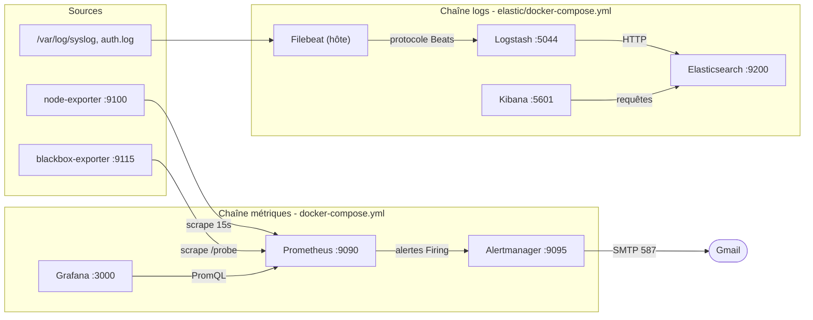
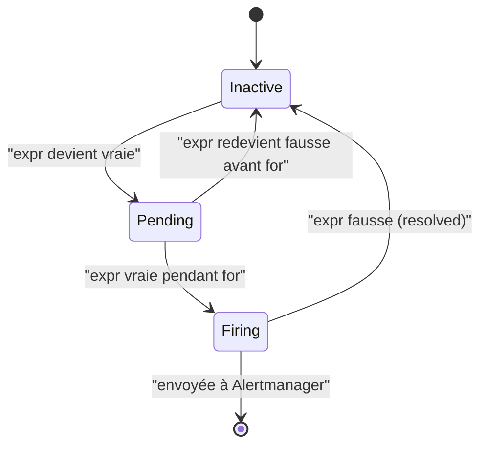
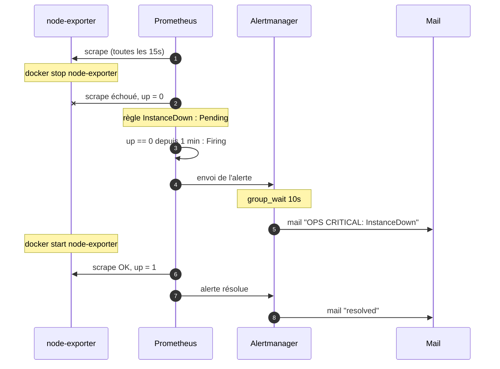
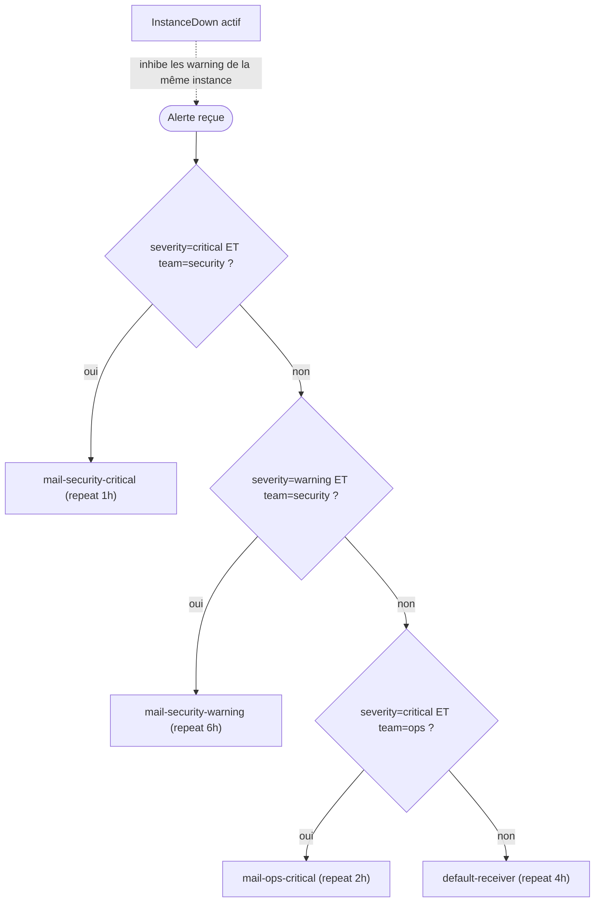
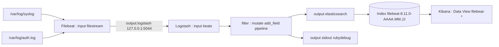

# TP_2_ALIBORA

Deux chaînes indépendantes : **métriques** (qu'est-ce qui se passe ?) et **logs** (pourquoi ça s'est passé ?).

## 1. Architecture globale



| Service | Port | Rôle |
| --- | --- | --- |
| Prometheus | 9090 | collecte + stockage TSDB + évaluation des règles |
| Alertmanager | 9095 (hôte) → 9093 | regroupe, route, inhibe, notifie |
| Grafana | 3000 | tableaux de bord (datasource Prometheus provisionnée) |
| Blackbox | 9115 | sondes HTTP / TCP depuis l'extérieur |
| Node exporter | 9100 | métriques de l'hôte (CPU, RAM, disque) |
| Elasticsearch / Kibana | 9200 / 5601 | stockage et exploration des logs |
| Logstash | 5044 / 9600 | entrée Beats / API de monitoring |

## 2. Cycle de vie d'une alerte



**Point clé :** `for: 1m` évite les faux positifs. Une alerte ne part qu'après 1 minute continue de condition vraie.

## 3. Scénario InstanceDown, de bout en bout



Délai attendu entre l'arrêt et le mail : environ 1 min 30 à 2 min (scrape + `for` + évaluation + `group_wait`).

## 4. Routage et inhibition dans Alertmanager



La première route qui correspond gagne (pas de `continue`).

| Alerte | Labels | Receveur |
| --- | --- | --- |
| InstanceDown | critical / ops | mail-ops-critical |
| ProbeFailed | critical / ops | mail-ops-critical |
| SslCertExpiresSoon | warning / security | mail-security-warning |
| HighCpuLoad | warning / ops | default-receiver (aucune route warning/ops) |
| DiskSpaceHigh | warning / ops | default-receiver (idem) |

> Le receveur `mail-security-critical` n'est déclenché par aucune règle actuelle : à signaler honnêtement, ou à illustrer en ajoutant une règle `critical / security`.

## 4 bis. Comment blackbox est interrogé (relabeling)


Prometheus n'interroge jamais Google : il interroge **blackbox**, qui sonde la cible. C'est pourquoi `up` vaut 1 même si le site est tombé, et pourquoi `ProbeFailed` surveille `probe_success == 0`.

## 5. Pipeline des logs



## 6. Démarrage

```bash
# 0) Secret (non versionné)
echo -n 'MOT_DE_PASSE_APPLICATION_GMAIL' > secrets/smtp_password

# 1) Métriques
docker compose up -d

# 2) Logs (Linux : sudo sysctl -w vm.max_map_count=262144)
cp elastic/.env.example elastic/.env
docker compose -f elastic/docker-compose.yml up -d

# 3) Filebeat sur l'hôte
curl -L -o filebeat.deb https://artifacts.elastic.co/downloads/beats/filebeat/filebeat-8.11.0-amd64.deb
sudo dpkg -i filebeat.deb && sudo cp filebeat/filebeat.yml /etc/filebeat/filebeat.yml
sudo systemctl enable --now filebeat
```
