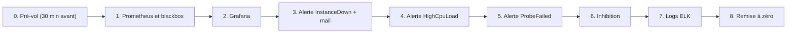

# Tests du jour de la présentation

Document de bord : à suivre dans l'ordre, avec le résultat attendu pour chaque test. Tous les chemins sont relatifs à la racine du projet.

## Ordre de la démo



| # | Test | Durée estimée |
| --- | --- | --- |
| 0 | Pré-vol | 5 min (avant la salle) |
| 1 | Prometheus et blackbox | 2 min |
| 2 | Grafana | 2 min |
| 3 | InstanceDown + mail + resolved | 4 min |
| 4 | HighCpuLoad | 4 min |
| 5 | ProbeFailed | 3 min |
| 6 | Inhibition | 2 min |
| 7 | Logs ELK | 3 min |

Les alertes demandent 1 à 2 minutes d'attente (`for: 1m` + `group_wait`). **Lance-les en avance et parle pendant l'attente.**

## 0. Pré-vol (30 minutes avant)

```bash
docker compose ps
docker compose -f elastic/docker-compose.yml ps
```

Script de vérification rapide (`preflight.sh`) :

```bash
#!/usr/bin/env bash
check(){ if curl -fsS -o /dev/null "$2"; then echo "OK   $1"; else echo "FAIL $1"; fi; }
check Prometheus     http://localhost:9090/-/ready
check Alertmanager   http://localhost:9095/-/ready
check Blackbox       "http://localhost:9115/probe?target=https://google.com&module=http_2xx"
check Grafana        http://localhost:3000/api/health
check Elasticsearch  http://localhost:9200
check Kibana         http://localhost:5601/api/status
check Logstash       http://localhost:9600
echo "Cibles DOWN : $(curl -s localhost:9090/api/v1/targets | grep -o '"health":"down"' | wc -l)"
echo "Règles chargées : $(curl -s localhost:9090/api/v1/rules | grep -o '"type":"alerting"' | wc -l) (attendu : 5)"
```

Lance-le avec `bash preflight.sh`. Tout doit être `OK`, 0 cible DOWN, 5 règles.

Checklist matérielle :

- [ ] Connexion internet active (les sondes blackbox visent Google et YouTube).
- [ ] Boîte mail ouverte dans un onglet, spams inclus.
- [ ] Onglets prêts : Prometheus `/alerts` et `/targets`, Alertmanager :9095, Grafana :3000, Kibana :5601.
- [ ] `secrets/smtp_password` présent, avec le **nouveau** mot de passe d'application.
- [ ] Terminal ouvert à la racine du projet.
- [ ] Captures d'écran de secours déjà faites.

## 1. Prometheus et blackbox

| Action | Résultat attendu |
| --- | --- |
| Ouvrir `/targets` | Toutes les cibles `UP` |
| Ouvrir `/rules` | Groupes `node_alerts` et `availability_alerts` |
| Requête `up` | Une ligne par cible, valeur 1 |
| Requête `probe_success` | Valeur 1 pour chaque site et port sondé |

```bash
curl -s "localhost:9115/probe?target=https://google.com&module=http_2xx" | grep -E "^probe_(success|http_status_code)"
```

Attendu : `probe_success 1` et `probe_http_status_code 200`.

**À dire :** Prometheus ne sonde pas Google lui-même, il interroge blackbox, qui sonde la cible (relabeling).

## 2. Grafana

1. Connections > Data sources > Prometheus > **Save & test** : succès.
2. Dashboard « Node Exporter Full » (n° 1860) ou le tien, avec les panneaux `up` et `probe_success`.
3. Laisse le dashboard ouvert pendant le test 3.

## 3. InstanceDown, mail et resolved

```bash
docker stop node-exporter
```

| Moment | À montrer |
| --- | --- |
| tout de suite | `up{job="node"}` tombe à 0 dans Grafana |
| \~15 à 60 s | Prometheus `/alerts` : InstanceDown **Pending** |
| \~1 min | InstanceDown **Firing** |
| \~1 min 30 à 2 min | Alertmanager : l'alerte apparaît, mail « OPS CRITICAL: InstanceDown » |

```bash
docker start node-exporter
```

Attendu : mail « resolved ». **À dire :** `for: 1m` évite les faux positifs.

## 4. HighCpuLoad

```bash
for i in $(seq $(nproc)); do yes > /dev/null & done
```

Attendu : Pending puis Firing après environ 1 à 2 minutes, mail via `default-receiver` (aucune route `warning` + `ops`).

Arrêt : `pkill yes`.

## 5. ProbeFailed

Ajoute une cible fausse dans `prometheus/prometheus.yml`, job `blackbox-http` :

```yaml
          - https://site-inexistant-tp.invalid
```

```bash
curl -X POST localhost:9090/-/reload
```

Attendu : `probe_success` à 0 pour cette cible, ProbeFailed Firing après 1 minute, mail critique. **À dire :** `up` reste à 1 pour une sonde blackbox, d'où la règle sur `probe_success`.

Si le reload ne prend pas en compte ta modification (fichier monté seul), utilise `docker compose up -d --force-recreate prometheus`.

## 6. Inhibition

Un vrai arrêt de node-exporter fait disparaître les séries CPU, donc l'effet est difficile à montrer en vrai. On le démontre avec deux alertes de test qui partagent le même label `instance` :

```bash
curl -XPOST localhost:9095/api/v2/alerts -H 'Content-Type: application/json' -d '[
 {"labels":{"alertname":"InstanceDown","severity":"critical","team":"ops","instance":"demo:9100"},"annotations":{"description":"test inhibition"}},
 {"labels":{"alertname":"HighCpuLoad","severity":"warning","team":"ops","instance":"demo:9100"},"annotations":{"description":"test inhibition"}}
]'
```

Attendu dans Alertmanager (:9095) : `InstanceDown` active, `HighCpuLoad` **inhibée** (coche « Inhibited » dans les filtres pour la voir). Un seul mail part, celui de l'alerte critique.

## 7. Logs ELK

```bash
curl -s localhost:9200 | head -n 5
curl -s "localhost:9200/_cat/indices?v" | grep filebeat
logger "test TP presentation"
docker logs logstash --tail 5
```

Dans Kibana : **Discover**, Data View `filebeat-*`, recherche `test TP presentation`. Attendu : l'événement apparaît avec le champ `pipeline: tp-monitoring`.

**À dire :** Filebeat collecte, Logstash transforme, Elasticsearch indexe, Kibana visualise.

## 8. Remise à zéro après la démo

```bash
docker start node-exporter
pkill yes
# retire la cible fausse de prometheus/prometheus.yml, puis :
curl -X POST localhost:9090/-/reload
```

Les alertes de test d'Alertmanager expirent seules (environ 5 minutes).

## Plan B si quelque chose casse

| Problème | Réaction |
| --- | --- |
| Pas de mail | Montre l'alerte dans Alertmanager, puis la capture du mail préparée |
| Pas d'internet | Les sondes échouent : explique-le et bascule sur une cible locale (`prometheus:9090`) |
| Kibana lent | Montre `curl localhost:9200/_cat/indices` et les captures |
| Alerte trop lente | Montre `/alerts` en Pending et explique `for` |
| Conteneur planté | `docker compose up -d --force-recreate <nom>` puis `docker logs <nom>` |

## Questions probables du jury

1. Pourquoi `for: 1m` plutôt qu'une alerte immédiate ?
2. Différence entre `group_wait`, `group_interval` et `repeat_interval` ?
3. Pourquoi `up` ne suffit-il pas pour blackbox ?
4. Pourquoi Filebeat envoie-t-il vers Logstash plutôt que vers Elasticsearch ?
5. À quoi sert l'inhibition ?
6. Pourquoi X-Pack est-il désactivé, et que ferais-tu en production ?